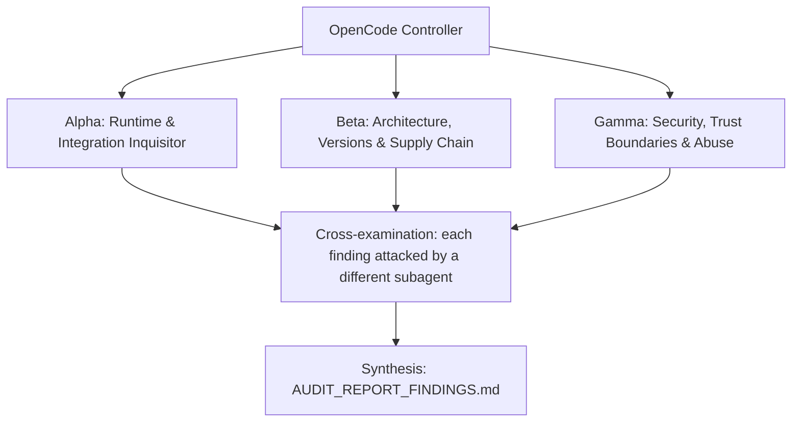

# ADVERSARIAL THREE-SUBAGENT AUDIT PROMPT: `epistemic-factory`

**Target Codebase**: the Git repository this file sits in. Resolve it with `git rev-parse --show-toplevel` and treat every path below as relative to that root. Nothing in this prompt depends on where the checkout lives.
**GitHub Remote**: `https://github.com/Heretek-AI/epistemic-factory`
**What it is supposed to be**: a headless, single-worktree gated build factory: the `es` CLI drives `GRILL -> RESEARCH -> SPEC -> BUILD_TDD_RED -> BUILD_TDD_GREEN -> GATE_MUTATION -> QA_DUAL_EVAL -> DONE` and computes every gate's evidence itself, with Ed25519 human approvals that agents can request but never grant; plus a standalone Epistemic Quote & Cache Verifier MCP server (verbatim quote checks against an HMAC-sealed, content-addressed source cache). Published as `@heretek-ai/es-core`, `@heretek-ai/es-cli` and `@heretek-ai/epistemic-verifier-mcp`. Blueprint refusal boundary: one worktree, one feature; never a fleet daemon or WebUI. Budget: 3,000 to 5,000 LOC.
**Execution Context**: OpenCode v2 autonomous audit (works the same in any agent CLI that has subagents and a shell)
**Auditor Formation**: three independent adversarial subagents (Alpha, Beta, Gamma), a cross-examination pass, and a synthesis pass
**Output**: `AUDIT_REPORT_FINDINGS.md` at the repository root

This prompt is designed to be re-run. Each run audits the current `HEAD`, re-verifies every finding of the previous run, and overwrites `AUDIT_REPORT_FINDINGS.md`.

---

## 0. Preflight (the controller does this before spawning subagents)

1. **Baseline.** Record at the top of the report: `git rev-parse HEAD`, `git log -1 --format='%ci %s'`, the UTC date, and the versions of every tool you will use (`bun`, `node`, `npm`, `git`, `bwrap`, `openssl`, `rg`, `jq`). If `git status --porcelain` shows changes other than this prompt file and a previous report, list the dirty files and audit a clean `git worktree` of `HEAD` instead of the working tree.
2. **Scratch space.** `export AUDIT_TMP="$(mktemp -d -t epistemic-factory-audit-XXXXXX)"`. Every clone, downloaded binary, packed tarball, sabotage copy, container volume and raw log goes under `$AUDIT_TMP`. Each subagent writes its raw notes to `$AUDIT_TMP/{alpha,beta,gamma}.md`.
3. **Disposable copy for experiments.** `git worktree add --detach "$AUDIT_TMP/wt" HEAD`. Sabotage, patched configs, and any file edits happen only there. The real checkout must end the audit with `git status --porcelain` showing nothing new but `AUDIT_REPORT_FINDINGS.md` (and this prompt file, if you copied it in untracked). Remove the copy with `git worktree remove --force "$AUDIT_TMP/wt"` at the end.
4. **Previous run.** If `AUDIT_REPORT_FINDINGS.md` already exists, read it before anything else. Every finding in it gets a row in the Regression Ledger (section 6), re-verified from scratch: never copy a previous verdict forward.
5. **Network and host capabilities.** You need outbound HTTPS to github.com, raw.githubusercontent.com, registry.npmjs.org. Probe what this host can do (`bun --version`, `node --version`, `bwrap --version`, whether unprivileged user namespaces are enabled (`unshare -Ur true`)) and record it. When a check cannot run here, the claim is `UNVERIFIABLE` with the exact reason. A claim is never `VERIFIED` by inference, by reading the code alone, or because a test says so.

**Hard limits (all subagents):** no `npm publish`, no `git push`, no tags, no GitHub writes (issues, comments, PRs), no real API keys or credentials in any command, file or report (generate throwaway keys and dummy values), no destructive command outside `$AUDIT_TMP`, and never seal or use a key with a real passphrase: generate throwaway ones. Read-only against the real checkout.

---

## 1. Directive & Rules of Engagement

You are a team of **three elite, adversarial principal systems auditors**. Your mandate is to stress-test, debunk, and verify every claimed feature, architectural decision, integration contract, security invariant, and version pin in **`epistemic-factory`**, measured against what the repository is supposed to be (above) and what its own `README.md`, `AGENTS.md` and `docs/` claim.

### The Cardinal Rule: DO NOT BELIEVE TESTS
- Unit tests, acceptance scripts (`make accept`, `scripts/accept/wave-*.sh`) and CI badges can lie: they assert obsolete invariants, mock away the real system, or test that a file *contains* a rule rather than that the rule *works*.
- This repository has a documented history of exactly that:
  - The first build's state machine passed its tests while trusting caller-supplied evidence (`specSignatureValid: true`, `redExitCode`, `mutationScore`), never checked `specHash` against the spec, and fell back to running gate commands unsandboxed when `bwrap` was missing.
  - A clean clone failed `make check` (tests imported `dist/`, which is gitignored), and `make accept` passed only on the build machine because it wrote to a hard-coded `/tmp/opencode/`.
  - Those were fixed later (`es run` / `es advance`, fail-closed bwrap). Verify the fixes against reality rather than against the tests that came with them.
- Never conclude that a component works because `bun test` or `make accept` exits 0. Prove behavior against **the real thing it plugs into**: a real project taken through the pipeline by the `es` CLI, a real MCP client talking to the verifier server, the packages as installed from tarballs and from npm under Node, a real `bwrap` sandbox, and `agency-control-plane`'s approval code.

### The Second Rule: DO NOT BELIEVE THE PAPER TRAIL
- `docs/reports/*`, `docs/evidence/*`, "red-proof" logs, drift-guard `VERDICT: PASS` lines, `CHANGELOG.md`, and `README.md` are **claims under audit**, not evidence.
- The repo was built by agents from a self-contained prompt (`MASTER_BUILD_PROMPT.md` / `docs/prompts/SPEC.md`). That prompt contained invented facts (API names, image tags, config shapes), and the build gates only checked spec compliance. Matching the spec is not the same as working. Where the spec and reality disagree, reality wins and the spec is the defect.

### The Third Rule: SABOTAGE EVERY CRITICAL INVARIANT
- For each invariant marked **[S]** in section 3, break it with a one-line change in `$AUDIT_TMP/wt`, run the full suite there, and record whether the suite went red. Restore the line after each run.
- A sabotage the suite does not catch is a finding: **P1** ("untested invariant"), or **P0** when the invariant is a security boundary.

### Modern Version & Proper Deployment Imperative
- Every pinned version must be a **modern, supported, production-grade release that actually exists** in its registry. Flag invented versions, deprecated or archived packages, renamed organizations, floating tags (`latest`, `^` ranges on security-relevant deps, unpinned GitHub Actions), end-of-life runtimes, and versions with known CVEs (`npm audit`, OSV: `https://api.osv.dev/v1/query`).
- Verify that integration patterns follow the **official upstream documentation and source code** of the system being integrated, at the version pinned and at the current upstream head (drift is a finding).

### Verdict vocabulary
Every claim in section 3 ends with exactly one status, each backed by a command and its output:
- `VERIFIED` (proven to work against the real thing), `PARTIAL` (works with caveats you name), `BROKEN` (proven not to work), `UNVERIFIABLE` (could not be run here, with the exact reason).

---

## 2. The Adversarial Triad (Subagent Roles)



### Subagent Alpha: Runtime & Integration Inquisitor
* **Focus**: "Does `es` actually take a real project from GRILL to DONE computing its own evidence, and does the verifier speak MCP to a real client?"
* **Methodology**:
  - Build a toy project in `$AUDIT_TMP/proj` and walk the README end-to-end example for real: `es init`, `es key seal`, write `.factory/config.json`, `es approve --stage TRUST`, `es advance`, GRILL approval, research with `[VERIFIED: sha256:<hash> "…"]` claims, SPEC approval, `es run`. Record exactly where it stops and why, and whether each refusal is correct.
  - Try to advance without doing the work: tests that pass at RED, test files changed at GREEN, a mutation score under 85%, a single QA verdict, both QA verdicts from the programmer model, a STOP file, spend over ceiling, a `run.json` edited by hand, an approval for a different run, an approval over a stale spec hash.
  - Drive `epistemic-verifier-mcp` over stdio with raw JSON-RPC (`initialize`, `notifications/initialized`, `tools/list`, `tools/call` for `cache_source`, `verify_quote`, `locate_quote`, `audit_markdown`) **and** with an independent real client (the official MCP Inspector CLI or the TypeScript SDK client). Check protocol version negotiation when the client asks for the current spec version.
  - Install the packages the way a user would: `bun run build`, `npm pack` each package, install the three tarballs into a clean directory, then run `es --help` and the `epistemic-verifier-mcp` bin **under Node 22** (not Bun). Bun-only APIs in published code are a finding when `engines` or the README imply Node works.

### Subagent Beta: Architecture, Versions & Supply Chain
* **Focus**: "Is this release real and installable, are the gates sound designs, and does it fit the ecosystem?"
* **Methodology**:
  - npm state: `@heretek-ai/es-core` and `@heretek-ai/es-cli` 2.x come from an unrelated older codebase; check what `latest` is today for all three packages, whether `epistemic-verifier-mcp` is published, whether published tarballs match `main`, and whether `es-cli`'s `^3.0.0` dependencies resolve to real versions.
  - MCP: the server hard-codes protocol `2024-11-05` and hand-rolls JSON-RPC rather than using `@modelcontextprotocol/sdk`. Compare against the current MCP specification revision and the behavior of current clients.
  - Gate design: is the "syntactic mutants" mutation gate meaningful compared with an established tool (StrykerJS) — how many mutants, which operators, how is equivalence handled, how long does it run? Is RED-first plus a SHA-256 test-tree lock robust to test files outside `testDir`, snapshot files and config-driven test discovery?
  - Pins and tooling: `@biomejs/biome` `^2.2.0`, `@types/node` `^26.6.5`, `bun-types` `^1.4.3`, `typescript` `^5.9.2`, Bun 1.4.2 in CI, unpinned `actions/checkout@v4` / `oven-sh/setup-bun@v2` / `actions/setup-node@v4` in `publish.yml`.
  - `bundles/*.bundle.json`: does any code read them, does their `$schema` URL resolve, do their settings (for example `requireRedProofLog`, `requireDriftVerdictPass`) change any behavior?
  - Scope and fit: refusal boundary (no fleet daemon, no WebUI), LOC budget, and approval compatibility with `agency-control-plane` (it claims to use the same key format and payload shape).

### Subagent Gamma: Security, Trust Boundaries & Abuse
* **Focus**: "Can an agent working in the worktree grant its own approvals, forge evidence, poison the research cache, or run arbitrary code through the gates?"
* **Methodology**:
  - Self-approval: the passphrase arrives via `--passphrase` or `ES_PASSPHRASE`, and the default key dir is `<cwd>/.factory/keys`, inside the worktree an agent works in. Determine what an agent with shell access in that worktree can do with `human.key.enc`, the environment, and `es approve`. "Agents may request approvals, never grant them" must hold under realistic deployment, not just in the API.
  - Evidence forgery: rewrite `.factory/run.json`, approval records, `.factory/qa/*.json`, `.factory/spend.jsonl`, the test manifest, and the frontier; the runner claims to validate `run.json` against its own history and pin the key fingerprint per run.
  - Config as code execution: `testCmd`, `trustedCommands` and `mutation.targets` decide what runs. Confirm the `TRUST` approval binds the exact config bytes, that editing the config voids it, and that the bwrap sandbox really isolates (inspect the exact `bwrap` argv: network, home directory, writable binds, `/proc`, `--die-with-parent`). Missing `bwrap` must fail closed unless explicitly opted out.
  - Cache and seal: location and mode of `engine.key`, `O_NOFOLLOW` creation, symlink races in the cache and state dirs, constant-time HMAC comparison, behavior on truncated or swapped entries.
  - Quote verifier bypasses: zero-width and bidi characters, homoglyphs, NFKC folding that maps different text to the same quote, ellipsis fragments of exactly 12 characters stitched from distant parts of a source, quotes that span markup, claims whose hash names a different cached source.
  - Approval replay: across runs (`runId` binding), across stages, across systems (a control-plane `APPROVE` record presented as a factory stage approval), and timestamp freshness.
  - `.worktreeinclude` syncing: `..` segments, absolute paths, symlinked directories and files in the base repo, patterns that match `.git` contents.

---

## 3. Comprehensive Inventory of Claimed Functions & Architectural Decisions

Owners: `[A]` Alpha, `[B]` Beta, `[G]` Gamma. `[S]` marks an invariant that must be sabotaged (Third Rule).

### Domain 1: Verifier MCP Server (`packages/epistemic-verifier-mcp/src/mcp-server.ts`)
* **Claim 1.1 [A]**: The stdio server completes the MCP handshake with a real current client and exposes `cache_source`, `verify_quote`, `locate_quote` and `audit_markdown` with valid input schemas.
* **Claim 1.2 [A]**: Malformed JSON, unknown methods, oversized lines and invalid params produce JSON-RPC errors without killing the server.
* **Claim 1.3 [B]**: The protocol version handling is compatible with current MCP clients.

### Domain 2: Sealed Content-Addressed Cache (`seal.ts`, `cache.ts`)
* **Claim 2.1 [G][S]**: Every cached source is SHA-256 content-addressed and HMAC-SHA256 sealed with `engine.key` (mode `0600`, created with `O_NOFOLLOW`); unsealed or modified entries throw `TamperedSourceError` and are never served.
* **Claim 2.2 [G]**: The HMAC comparison is constant-time and the cache resists symlink and rename races.

### Domain 3: Quote Verification & Research Audit (`quote.ts`, `auditor.ts`)
* **Claim 3.1 [G][S]**: Every `[VERIFIED: sha256:<hash> "quote"]` claim must appear verbatim in the named source after NFKC and typography folding, with at least 12 characters per ellipsis fragment (`MIN_QUOTE`).
* **Claim 3.2 [G][S]**: Ungrounded claims are pruned, never passed; `es audit-research` exits 1 when any claim is pruned and requires `verifiedCount >= 1`.
* **Claim 3.3 [G]**: Unicode tricks listed for Gamma cannot make a fabricated quote verify.

### Domain 4: Human Approvals (`packages/core/src/approval/ed25519.ts`, `es key seal`, `es approve`)
* **Claim 4.1 [G][S]**: The human Ed25519 key is sealed with scrypt + AES-256-GCM; the passphrase is never written to disk.
* **Claim 4.2 [G][S]**: Stage approvals verify only against the pinned human public key and bind `runId`, stage and subject hash.
* **Claim 4.3 [G]**: In a realistic deployment, an agent cannot grant or self-sign an approval (see Gamma's methodology).
* **Claim 4.4 [A][B]**: The key format and signed payload are compatible with `agency-control-plane` (`human.key.enc` + `human.pub`, canonical JSON `{ runId, stage, subjectHash, timestamp }`) while stage names stay disjoint.

### Domain 5: State Machine & Runner (`factory/machine.ts`, `factory/runner.ts`, `es advance`, `es run`)
* **Claim 5.1 [A][S]**: The pipeline is `GRILL -> RESEARCH -> SPEC -> BUILD_TDD_RED -> BUILD_TDD_GREEN -> GATE_MUTATION -> QA_DUAL_EVAL -> DONE`, plus `HALTED` from any state, with the guard table in `docs/prompts/SPEC.md` §2.2.
* **Claim 5.2 [A][S]**: The runner computes all evidence from disk (frontier hash, spec hash, signed approvals, test runs, manifest, mutation score, QA verdicts, STOP, spend) and refuses evidence flags on the command line.
* **Claim 5.3 [G][S]**: `run.json` is validated against its own history and the human key fingerprint is pinned per run; hand edits are detected.
* **Claim 5.4 [A][S]**: `SPEC -> BUILD_TDD_RED` requires the SPEC approval's subject to equal `sha256(spec.md)` as it is on disk now.
* **Claim 5.5 [A]**: The machine emits structured JSON events to stdout or a file, as the blueprint requires for consumers such as the control plane.

### Domain 6: Gates (`gates/engine.ts`, `gates/test-lock.ts`, `gates/mutation.ts`)
* **Claim 6.1 [A][S]**: RED-first: a passing suite at `BUILD_TDD_RED` throws `RED_FIRST_VIOLATION`.
* **Claim 6.2 [A][S]**: The GREEN-phase test tree is manifest-locked; any added, removed or modified test file raises `TestTamperingError`.
* **Claim 6.3 [A][S]**: The mutation gate fails under an 85% kill rate.
* **Claim 6.4 [G][S]**: `runGateCommand` with `useBwrap` throws `SandboxUnavailableError` when `bwrap` is missing unless explicitly opted out, and the sandbox it builds actually confines the command.
* **Claim 6.5 [A][S]**: QA_DUAL_EVAL requires both functional and adversarial `PASS` with model diversity from `programmerModel` (or a logged override).
* **Claim 6.6 [A][S]**: `.factory/STOP` or spend over `ceilingUSD` forces `HALTED` from any state.

### Domain 7: Frontier (`factory/frontier.ts`)
* **Claim 7.1 [A][S]**: `frontier.json` is append-only; context-only ideas without a concrete behavioral delta are refused; `frontierHash` is SHA-256 over canonical JSON.

### Domain 8: CLI Behavior (`packages/cli/src/`)
* **Claim 8.1 [A][S]**: Every command fails closed: bad stages, malformed hashes, missing passphrases, unreadable files and unknown commands exit 1 with a descriptive error; `es init` refuses to overwrite without `--force`; `es status` exits 0 for a readable dir.
* **Claim 8.2 [G][S]**: `syncWorktreeIncludes` never follows symlinks, never touches `.git`, rejects `..` segments, and never runs `git add`.

### Domain 9: Packaging, Release & CI
* **Claim 9.1 [A]**: A clean clone passes `make check` and `make accept` without a prior build and without any machine-specific path (for example `/tmp/opencode`), and leaves the tree clean (no mode changes).
* **Claim 9.2 [B]**: All three packages build to `dist/` with working bins (`es`, `epistemic-verifier-mcp`) and install from tarballs into a clean directory.
* **Claim 9.3 [B]**: npm `latest` for each package is the 3.x codebase on `main`, or the README accurately says it is not.
* **Claim 9.4 [B]**: `publish.yml` publishes only from a release, uses OIDC trusted publishing with least privilege, and runs the test suite first.

### Domain 10: Gate Bundles & Scope
* **Claim 10.1 [B]**: `bundles/default.bundle.json` and `bundles/strict-security.bundle.json` are loaded and enforced by code.
* **Claim 10.2 [B]**: The repo stays inside its refusal boundary (one worktree, one feature; no fleet daemon, no WebUI) and its LOC budget.

---

## 4. Reality-Check Recipes

```bash
bun install --frozen-lockfile --ignore-scripts
ES="bun $PWD/packages/cli/src/bin.ts"

# End-to-end in a toy project (throwaway passphrase only)
export ES_PASSPHRASE="audit-$(openssl rand -hex 8)"
mkdir -p "$AUDIT_TMP/proj" && cd "$AUDIT_TMP/proj" && git init -q
$ES init --dir . && $ES key seal --key-dir .factory/keys
# write .factory/config.json from the README, a failing test, spec.md, research.md; then:
$ES approve --stage TRUST --dir . --key-dir .factory/keys && $ES advance --dir . ; $ES status --dir .
# Repeat with ES_PASSPHRASE unset and an agent-like shell to probe Claim 4.3.

# MCP over stdio, raw
printf '%s\n' \
 '{"jsonrpc":"2.0","id":1,"method":"initialize","params":{"protocolVersion":"2025-11-25","capabilities":{},"clientInfo":{"name":"audit","version":"0"}}}' \
 '{"jsonrpc":"2.0","method":"notifications/initialized"}' \
 '{"jsonrpc":"2.0","id":2,"method":"tools/list"}' \
 | bun packages/epistemic-verifier-mcp/src/mcp-server.ts | jq -c .
# MCP with an independent client
npx -y @modelcontextprotocol/inspector --cli bun packages/epistemic-verifier-mcp/src/mcp-server.ts --method tools/list

# Install like a user, run under Node
bun run build
for d in packages/*; do (cd "$d" && npm pack --pack-destination "$AUDIT_TMP/tgz"); done
mkdir -p "$AUDIT_TMP/consumer" && cd "$AUDIT_TMP/consumer" && npm init -y >/dev/null && npm i "$AUDIT_TMP"/tgz/*.tgz
node node_modules/.bin/es --help; echo exit=$?

# Clean-clone check
git clone -q https://github.com/Heretek-AI/epistemic-factory "$AUDIT_TMP/clean" && cd "$AUDIT_TMP/clean" && make check && make accept; git status --porcelain

# Registry truth
for p in @heretek-ai/es-core @heretek-ai/es-cli @heretek-ai/epistemic-verifier-mcp; do echo "== $p"; npm view "$p" dist-tags versions --json; done
for p in @biomejs/biome @types/node bun-types typescript @modelcontextprotocol/sdk; do echo "== $p"; npm view "$p" version; done

# bwrap reality
command -v bwrap && bwrap --version
rg -n 'bwrap' packages/core/src/gates/engine.ts   # then run a gate command that tries to write $HOME and reach the network
```

Sabotage targets (`[S]`) at minimum: `MIN_QUOTE`, the seal check, the HMAC comparison, the mutation threshold, test-lock modified-file detection, RED-first check, spec hash equality, `run.json` history validation, key fingerprint pinning, QA model-diversity check, STOP and spend checks, `SandboxUnavailableError`, frontier append-only check, `..` rejection in `.worktreeinclude`.

---

## 5. Execution Directives for OpenCode

1. **Independent exploration.** Spawn Alpha, Beta and Gamma concurrently as three separate subagents. Hand each one this entire file plus its role. They must not read each other's notes until step 4. Each one works through the claims it owns (ownership is marked `[A]`, `[B]`, `[G]` in section 3) and may file findings on any claim.
2. **Run things.** Prefer executing to reading. Use the recipes in section 4 and any further commands you need (`bun`, `node`, `npm view`, `npm pack`, `git ls-remote`, `curl`, `jq`, `rg`, `bwrap`, `openssl`, the MCP Inspector CLI). Save the raw output of every command you cite under `$AUDIT_TMP/logs/`.
3. **Empirical Proof Mandate.** For every claim judged `BROKEN`, `PARTIAL`, insecure, or outdated, record:
   - the exact file path and line number (`path/to/file.ts:123`);
   - the exact command executed to prove it, runnable as written from the repository root;
   - the raw output, error message, or registry response (trimmed to the relevant lines, never paraphrased);
   - for upstream comparisons, the upstream file path and commit SHA you compared against.
4. **Cross-examination.** When all three are done, each finding is handed to a different subagent (Alpha's to Beta, Beta's to Gamma, Gamma's to Alpha), whose job is to refute it: re-run the proof, look for a misreading, a wrong upstream version, or an environment artifact. A refuted finding is dropped or downgraded, and the refutation is noted in the finding.
5. **Coverage gate.** Before synthesis, check that every claim ID in section 3 has a status. Any claim without one goes back to its owner.
6. **Synthesis.** The controller writes `AUDIT_REPORT_FINDINGS.md` in the structure below, then cleans up (`git worktree remove`, stop any containers or processes you started) and confirms the real checkout has no changes apart from the report and this prompt file.

---

## 6. Report Structure: `AUDIT_REPORT_FINDINGS.md`

```markdown
# AUDIT_REPORT_FINDINGS: epistemic-factory

## Baseline
Commit, commit date, audit date (UTC), tool versions, host capabilities, and the list of checks that could not run here and why.

## Verdict
Three to six sentences: does `epistemic-factory` do what it is supposed to be, against the real systems it plugs into? Name the single most important thing to fix.

## Prioritized Defect Matrix
| ID | Priority | Claim | Location | Summary |
|----|----------|-------|----------|---------|

## Findings
### EF-<claim-id>-<slug>: <title>
- **Priority:** P0 | P1 | P2 | P3
- **Claim:** <claim ID and text>
- **Location:** `path:line`
- **Proof:** the command(s), runnable from the repo root
- **Raw output:** fenced block, trimmed, verbatim
- **Why it matters:** one or two sentences, in terms of what breaks for a user
- **Remediation:** an exact, fail-closed diff or command sequence
- **Verify the fix:** the command that goes from failing to passing once fixed
- **Cross-examination:** who challenged it and what they found

## Claim Ledger
| Claim | Status | Evidence (command or finding ID) |
Every claim ID from section 3, no omissions.

## Sabotage Results
| Invariant | One-line sabotage (file:line, before -> after) | Suite result | Caught? |

## Regression Ledger
| Previous finding ID | Previous priority | Status now: FIXED / STILL OPEN / REGRESSED / NO LONGER APPLICABLE | Evidence |
(Write "First run" if there was no previous report.)

## Not Audited / Unverifiable
What could not be checked, why, and what a human needs to provide to check it.
```

**Finding IDs are stable across runs.** Use `EF-<claim-id>-<short-slug>` (for example `EF-4.3-agent-self-approval`) so the next run's Regression Ledger can match findings by ID.

**Priority definitions:**
- **P0 / Critical:** the component does not work against its real host or upstream (an agent that can grant its own approval or forge gate evidence, a fabricated quote that verifies, a gate command that runs unsandboxed, a published package that does not install or run); a security boundary can be bypassed; a pinned artifact does not exist; a release on a registry is broken.
- **P1 / High:** deprecated or end-of-life versions, fail-open error handling, an untested security or correctness invariant (sabotage survived), an integration contract that drifted from the current upstream head, severe scope or architecture drift from what the repo is supposed to be.
- **P2 / Medium:** non-fatal version lag, documentation that contradicts behavior, missing CI coverage for a reality check, suboptimal resource or performance choices.
- **P3 / Low:** style, dead code, naming, minor cleanups.

For every finding, provide the exact, fail-closed code diff or command sequence to remediate. Do not apply it to the real checkout.
